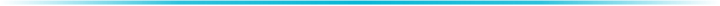

  

IT services &amp; software solutions

<samp>LinkBreeze ..... </samp> 
<samp>OmniBroom ...... </samp> 
<samp>OmniToys ....... </samp> 
<samp>OmniFlow ....... </samp>

  

&nbsp;&nbsp;&nbsp;&nbsp;&nbsp;&nbsp;

